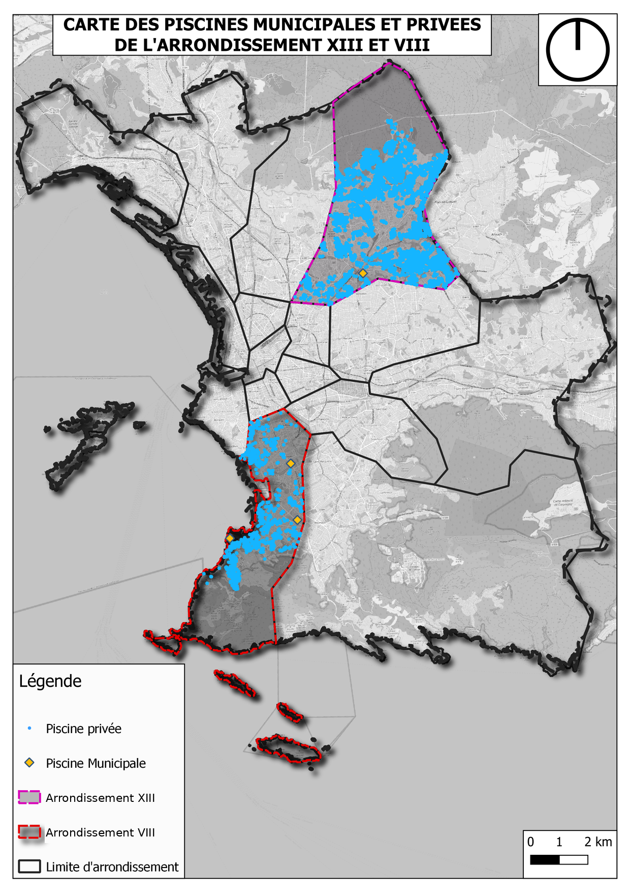
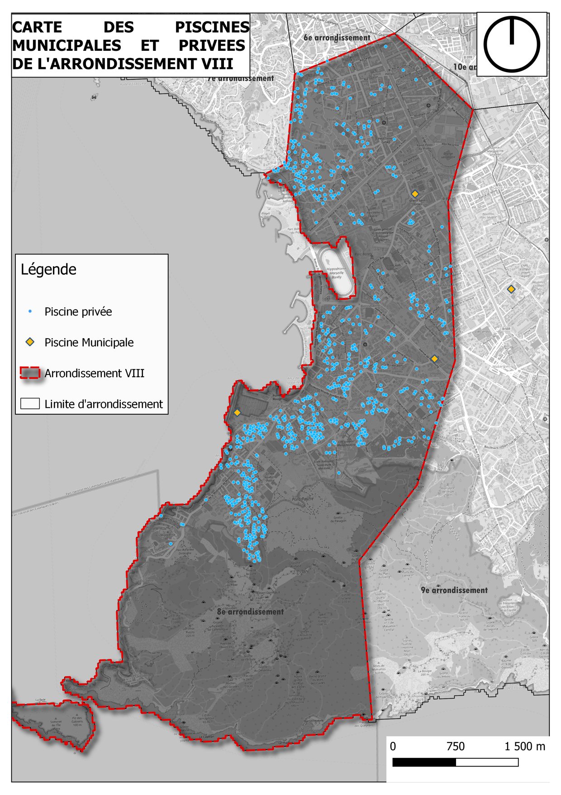
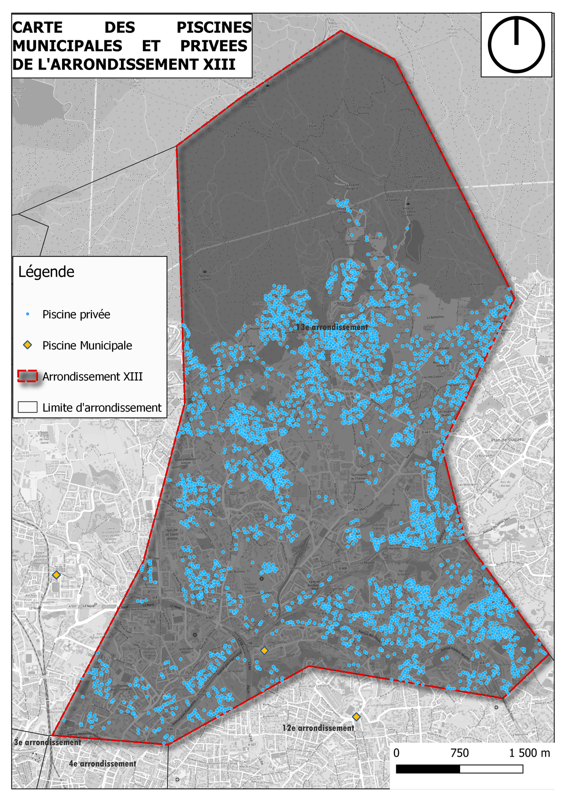
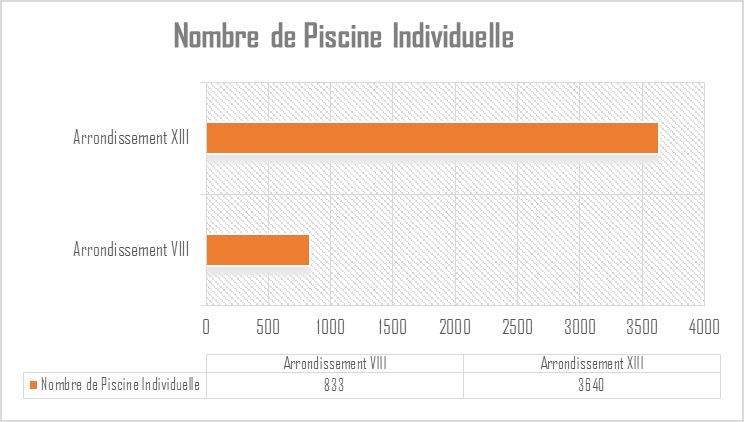
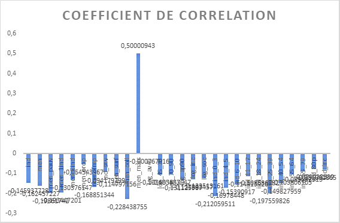
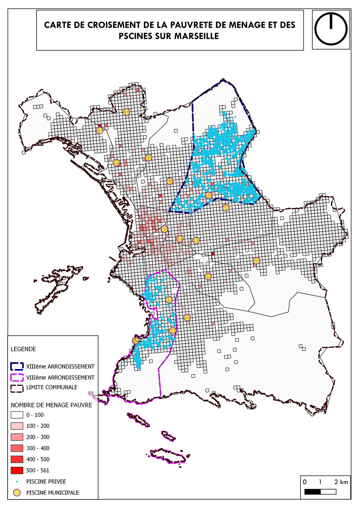
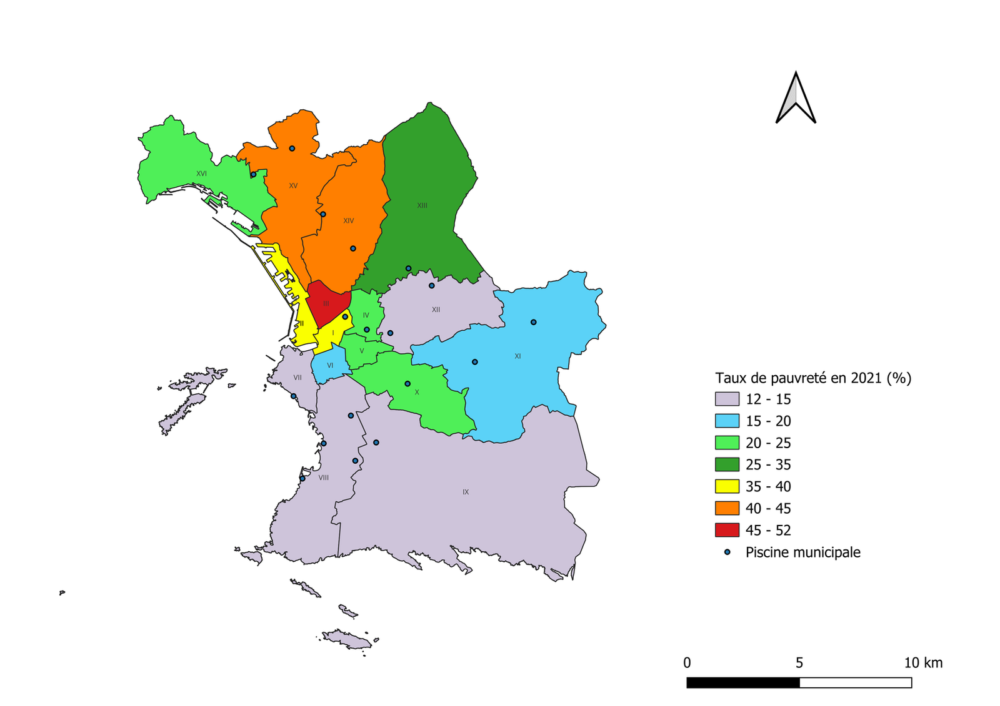
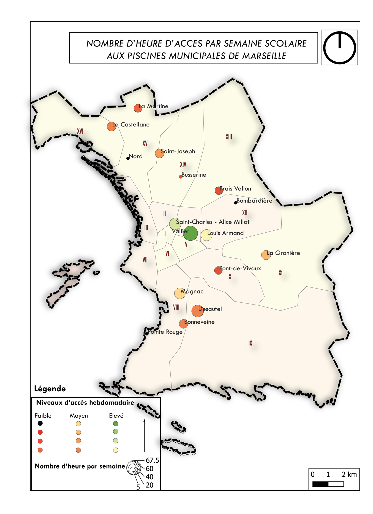
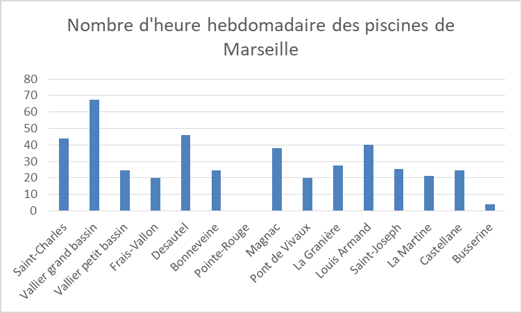

# Piscines et inégalités face à la chaleur à Marseille (8e et 13e arrondissements)

> Qui peut se rafraîchir quand il fait chaud ? Numérisation des piscines privées, croisement avec le carroyage INSEE et lecture de l'offre municipale.
> *Mapping private and municipal swimming pools in Marseille and crossing them with INSEE 200 m grid data to reveal unequal access to cooling.*



**Master 1 Géomatique et modélisation spatiale (GMS)**, Aix-Marseille Université · 2025-2026
UE *HGABU30, Mener un projet scientifique* · **Travail de groupe interdisciplinaire** : Peycheva, Roussier (COAST), Trambowicz, Soukou (GMS)

---

## Question

*Comment l'accès inégal aux piscines publiques et leur manque à Marseille cristallisent-ils les inégalités sociales face au réchauffement climatique ?*

**Contexte.** Marseille s'est réchauffée de **+1,8 °C depuis les années 1960**. Le parc de piscines municipales est vieillissant (âge moyen supérieur à 50 ans), et pendant l'été 2021, seules **3 piscines sur 14** étaient ouvertes. L'offre est tombée à **1,03 m² de bassin pour 1 000 habitants** cette année-là, contre 13 m² en moyenne nationale.

## Données

| Donnée | Source | Usage |
|---|---|---|
| **Piscines privées** | Numérisation sur images satellites | Inventaire exhaustif dans les 8e et 13e |
| **Piscines municipales** | Ville de Marseille | Localisation et horaires d'ouverture |
| **Carroyage INSEE 200 m** (Filosofi) | INSEE | 28 indicateurs socio-économiques |
| **Taux de pauvreté par arrondissement** (2021) | INSEE | Lecture à l'échelle de la ville |

## Méthode

1. **Numérisation** des piscines privées des 8e et 13e arrondissements sous QGIS
2. **Comptage** des piscines privées et municipales par arrondissement, rapporté à la population
3. **Croisement avec le carroyage INSEE 200 m** : nombre de piscines par carreau confronté à 28 indicateurs, avec un **coefficient de corrélation de Pearson** pour chacun
4. **Lecture de l'offre publique** : localisation, nombre d'heures d'accès par semaine, pauvreté par arrondissement

## Résultats clés

| | 8e arrondissement | 13e arrondissement |
|---|---:|---:|
| Population | 85 931 | 95 852 |
| Piscines **privées** numérisées | **833** | **3 640** |
| Piscines **municipales** | 3 | 1 |

- **Le facteur le plus lié aux piscines privées est la maison individuelle.** La corrélation la plus forte (**r ≈ 0,50**) est avec le nombre de ménages vivant en maison (`men_mais`) ; les autres indicateurs sont faibles ou négatifs.
- **Il y a une double inégalité.** Le 8e cumule l'accès à la mer et 3 piscines municipales. Le 13e, excentré, n'a qu'une piscine municipale, et ses piscines privées sont concentrées dans les secteurs pavillonnaires.
- **Les habitants des quartiers denses n'ont presque aucune solution.** Ceux qui vivent en appartement, souvent dans les secteurs les plus chauds et les plus pauvres, dépendent d'une offre publique rare et éloignée.
- **À l'échelle de la ville, plusieurs arrondissements centraux** (2e, 3e, 5e, 6e, 7e) n'ont aucune piscine alors qu'ils comptent parmi les plus pauvres et les plus exposés aux îlots de chaleur.

| 8e arrondissement | 13e arrondissement |
|---|---|
|  |  |



| Corrélations piscines privées × indicateurs INSEE | Pauvreté des ménages et piscines |
|---|---|
|  |  |

| Taux de pauvreté et piscines municipales | Heures d'accès aux piscines municipales |
|---|---|
|  |  |



## Lien avec l'aménagement

Ce diagnostic rejoint les priorités du plan **« Nager à Marseille »** et la création d'**îlots de fraîcheur**. Il plaide pour cibler les nouveaux équipements (bassins mobiles, piscines de proximité) sur les quartiers denses et défavorisés plutôt que sur de grands complexes. Le projet s'est appuyé sur des échanges avec les services de la Ville de Marseille.

## Limites

- Numérisation dépendante de la date et de la résolution des images (petits bassins, bassins couverts ou ombragés).
- Données de pauvreté de 2021 ; corrélation ne veut pas dire causalité.
- Pas de données de fréquentation ni de capacité des piscines municipales.

## Outils

`QGIS` · numérisation · carroyage INSEE 200 m · corrélations de Pearson · `Excel`

## Contenu du dépôt

```
└── figures/   cartes 8e / 13e, comptages, corrélations, pauvreté, horaires
```

---

**Auteur :** Ezechiel Agbewanou SOUKOU, géomaticien-urbaniste · [LinkedIn](https://www.linkedin.com/in/ezechiel-soukou) · [Autres projets](https://github.com/ezekielofficiel7-spec)
